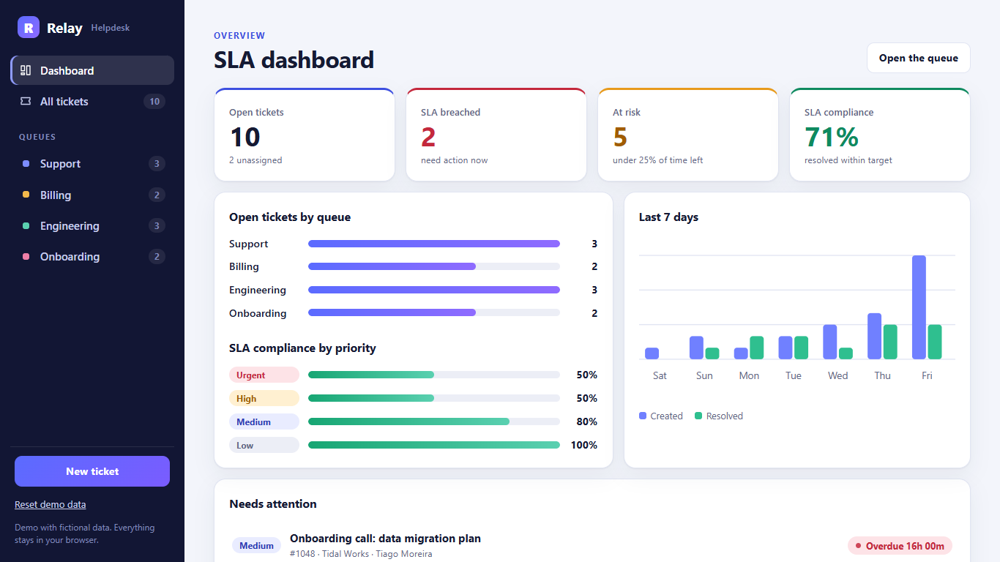
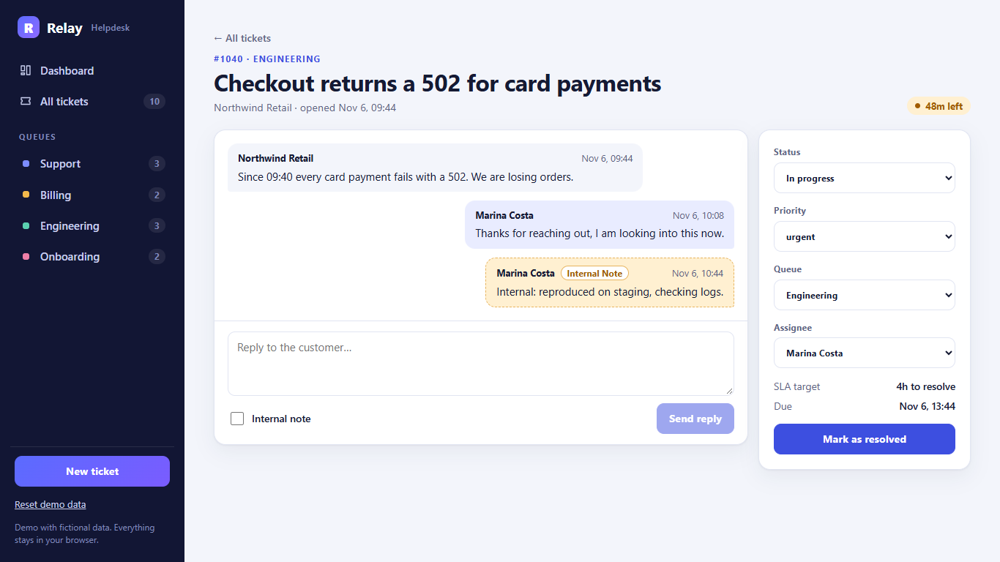
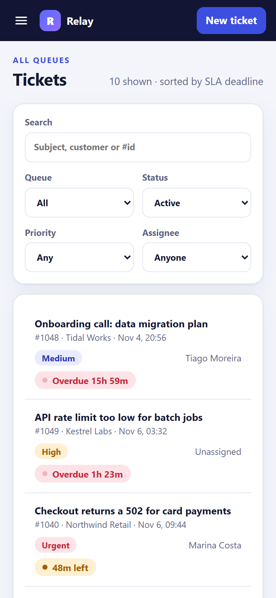

# Relay Helpdesk

[](https://github.com/alissonlittig/relay-helpdesk/actions/workflows/ci.yml)

A support desk front end built with **Angular 22**: prioritised tickets, queues, live SLA countdowns, an agent conversation thread with internal notes, and an SLA dashboard. Everything runs in the browser with fictional data stored in `localStorage`.

**Live demo:** https://alissonlittig.github.io/relay-helpdesk/



| Ticket thread | Mobile (390 px) |
| --- | --- |
|  |  |

## Features

- **Tickets** with priority (urgent / high / medium / low), status, queue and assignee; create, edit and resolve or reopen.
- **SLA engine**: resolution target per priority (4h / 8h / 24h / 72h), states `ok`, `risk` (under 25% of time left), `breached`, `met` and `missed`, with a countdown that refreshes every 30 s.
- **Queues** (Support, Billing, Engineering, Onboarding) with live open counts, plus search and filters by status, priority and assignee. The list is sorted by SLA deadline.
- **Conversation thread** with customer messages, agent replies, internal notes and system events.
- **Dashboard**: open, breached, at-risk and compliance KPIs, open tickets per queue, compliance by priority, and created vs resolved for the last 7 days (hand-written SVG, no chart library).
- Responsive down to 390 px, keyboard friendly, skip link, visible focus, reduced-motion support.

## Stack

- Angular 22, standalone components, **signals** (`signal`, `computed`, `input`), new control flow (`@if`, `@for`)
- TypeScript (strict), SCSS, lazy-loaded routes, hash routing for GitHub Pages
- Unit tests with Vitest through the Angular `unit-test` builder (SLA rules and store behaviour)
- GitHub Actions: test, build and deploy to GitHub Pages

## Run it

```bash
npm ci
npm start          # http://localhost:4200
npm test           # unit tests
npm run build      # output in dist/helpdesk/browser
```

## Structure

```
src/app/core    models, SLA rules (sla.ts), signal store with localStorage (store.ts), demo data
src/app/pages   dashboard, tickets list, ticket detail
```

## Notes

The data is fictional and generated relative to the current time, so there are always a few breached and at-risk tickets. Use **Reset demo data** in the sidebar to start over. There is no backend; the store is the only place to change if you want to plug one in.

MIT licensed.
